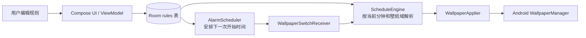

# Screensaver

一个完全在 Android 设备本地运行的定时壁纸应用。用户可以从系统文件选择器选择自己的图片，并为锁屏和桌面分别设置每天重复的时间规则。

> 当前版本：`0.01`（Android `versionCode = 1`）
> 本仓库以源码保存、学习和技术交流为主要目的，不提交 APK/AAB，也不提供应用商店发行包。

## 项目定位

Screensaver 当前实现的是“定时更换系统壁纸”，不是 Android Daydream 屏保服务：

- `LOCK` 域控制锁屏壁纸；
- `SYSTEM` 域控制桌面壁纸；
- 两个域拥有彼此独立的规则和时间线；
- 图片始终位于用户本机，规则保存在应用本地数据库中，不依赖账号、服务器或网络接口。

最初需求是让用户选择本地图片，并按照例如“09:00–17:00 使用图片 A、17:00–24:00 使用图片 B”的规则自动切换。当前代码在此基础上增加了双壁纸域、规则冲突校验、开机恢复、精确闹钟降级和电池优化引导。

## 主要能力

- 通过 Storage Access Framework 选择本地 JPG/PNG 图片，并持久保留读取授权；
- 分别创建、编辑和删除锁屏/桌面壁纸规则；
- 规则按分钟设置，并按天循环；
- 同一壁纸域内禁止时间段重叠，不同域可以使用相同时间段；
- 应用启动、规则保存、系统开机和闹钟到点时重新解析当前规则；
- 只维护一个“下一次规则开始”闹钟，不轮询、不使用常驻前台服务；
- 精确闹钟权限不可用时自动降级为非精确闹钟；
- 支持立即应用当前规则，便于预览和排查；
- 图片在设置壁纸前按屏幕尺寸降采样，降低大图解码时的内存峰值。

## 工作原理



一条规则使用当天分钟区间 `[start, end)`：开始时间包含在区间内，结束时间不包含。单条规则不能跨越午夜；例如 `22:00–02:00` 需要拆成 `22:00–24:00` 与 `00:00–02:00` 两条规则。

调度器只关注合法且已绑定图片的规则开始时间。闹钟触发后，应用读取 Room 的最新规则，分别解析 `LOCK` 和 `SYSTEM` 当前命中项，设置壁纸，然后安排下一次闹钟。规则结束但没有下一条规则开始时，应用不会恢复旧壁纸，而是保持设备当前壁纸。

## 技术栈

| 类别 | 当前实现 |
| --- | --- |
| 语言与界面 | Kotlin、Jetpack Compose、Material 3 |
| 架构 | 单模块、MVVM、手动依赖注入 |
| 持久化 | Room 单表数据库 |
| 调度 | AlarmManager + BroadcastReceiver |
| 图片访问 | Storage Access Framework + 持久 URI 授权 |
| 壁纸设置 | WallpaperManager |
| Android SDK | minSdk 24、targetSdk 34、compileSdk 34 |
| 构建基线 | Gradle 8.9、AGP 8.5.2、Kotlin 1.9.24、JDK 21 |

## 获取与运行

### 环境要求

- Android Studio；
- JDK 21，推荐直接使用 Android Studio 提供的 JetBrains Runtime 21；
- Android SDK 34；
- Android 7.0（API 24）或更高版本的设备。

### 使用 Android Studio

1. 使用 Android Studio 打开仓库根目录。
2. 将 Gradle JDK 设为 JDK/JBR 21，等待 Gradle Sync 完成。
3. 连接真机或启动模拟器，选择 `app` 配置后运行。
4. 在首页选择“屏保壁纸”或“桌面壁纸”，新建时间规则并通过系统文件选择器选图。
5. 根据首页提示决定是否授予精确闹钟能力和忽略电池优化权限。

精确闹钟或电池优化豁免未授权时，应用仍可运行，但后台切换可能延迟或被厂商系统限制。

### 命令行验证

Windows：

```powershell
.\gradlew.bat :app:testDebugUnitTest :app:lintDebug :app:assembleDebug
```

macOS / Linux：

```bash
./gradlew :app:testDebugUnitTest :app:lintDebug :app:assembleDebug
```

仓库不要求预先打包 APK。只有需要在设备上安装调试时才需要执行 `assembleDebug`；生成物位于 `app/build/outputs/`，并已被 Git 忽略。

## 权限说明

| 能力 | 用途 | 未获得时的行为 |
| --- | --- | --- |
| `SET_WALLPAPER` | 设置锁屏和桌面壁纸 | 无法完成壁纸设置 |
| `RECEIVE_BOOT_COMPLETED` | 重启后恢复闹钟和当前壁纸 | 需要再次打开应用恢复 |
| `SCHEDULE_EXACT_ALARM` | API 31+ 尽量准时触发 | 降级为允许待机的非精确闹钟 |
| `REQUEST_IGNORE_BATTERY_OPTIMIZATIONS` | 引导用户降低后台冻结概率 | 部分 ROM 可能延迟或阻止后台执行 |
| SAF 持久 URI 授权 | 重启后继续读取用户选择的图片 | 图片不会被保存为可用规则 |

应用不申请通用存储权限，也没有网络权限。图片文件不会被复制到项目数据库或上传到服务器；Room 只保存其 `content://` URI。

## 规则约束

- 时间范围必须满足 `0 ≤ start < end ≤ 1440`；
- 同一域内规则不得重叠，跨域规则互不冲突；
- 新建规则默认继承首页当前选择的壁纸域；
- 每条规则必须绑定一张已取得持久读取授权的图片；
- 无命中规则、无有效图片或设置失败时，应用保持现有壁纸；
- 删除或替换图片后，只有当没有其它规则引用旧 URI 时才释放其读取授权。

## 已知限制

- 用户强制停止应用后，Android 会阻止闹钟和广播；必须重新打开应用才能恢复。
- 部分厂商 ROM 可能限制后台执行或拒绝第三方设置锁屏壁纸。
- 亮屏补偿只在应用进程存活时有效，不能代替系统闹钟。
- 当前没有监听手动改时和时区变化，相关变化要等下一次重排入口才能校正。
- Room 当前使用破坏性迁移策略，数据库结构升级可能清空已有规则。
- 系统闹钟、广播与 WallpaperManager 尚无自动化仪器测试，相关改动仍需真机验证。
- Daydream 屏保模式尚未实现。

## 文档导航

- [文档索引](docs/README.md)：区分产品意图、当前实现、运行证据和历史资料；
- [原始需求](docs/Base_document/原始需求清单-20260821.md)：项目最初的五项诉求；
- [需求文档](<docs/Milestone document/REQ_屏保需求_20260821.md>)：产品范围、功能目标与长期决策；
- [架构文档](docs/架构文档.html)：组件关系、数据契约、权限和当前限制；
- [应用流程文档](docs/应用流程文档.html)：规则保存、闹钟循环、壁纸应用与恢复路径；
- [UI 视觉规范](<docs/Milestone document/DESIGN_UI视觉规范_20260901.md>)：界面设计与交互基线。

如果只想快速理解代码，建议依次阅读：

1. `ScheduleRuleEntity.kt`：规则的数据结构；
2. `ScheduleEngine.kt`：时间区间和分域解析；
3. `AppContainer.kt`：共享应用流程；
4. `AlarmScheduler.kt`：单闹钟链式调度；
5. `WallpaperApplier.kt`：图片解码与系统壁纸调用；
6. `RuleEditorViewModel.kt`：保存和冲突校验。

## 许可证

本项目采用 [MIT License](LICENSE)。
